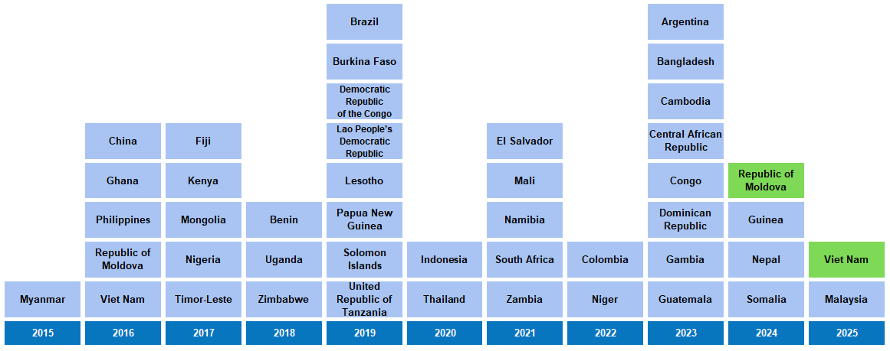

```{r setup, include=FALSE}

# Set chunk options.
# Results "asis" is needed to avoid xtable output being html encoded
# Suppress messages, warnings and also the ## at the beginning of printed text
# Set a default figure width too.

knitr::opts_chunk$set(echo = FALSE, 
                      results = "asis",
                      message = FALSE,
                      warning = FALSE,

                      # Settings for better output of whomapper .png maps
                      fig.width = 10,
                      fig.height = 5,
                      dpi = 350
                      )


# Load output packages ----
# - - - - - - - - - - - - - - - - - - - - - - - - - - - - - - - - - -
library(ggplot2)
library(dplyr)
library(scales)
library(RColorBrewer)
# devtools::install_github("yamanakatakuya/whomapR")
# from https://github.com/yamanakatakuya/whomapR
library(whomapR)
library(gtbreport)
library(here)
library(Cairo)
library(cowplot)
library(stringr)


library(tidyverse)

library(jsonlite)

# Load R functions ----
# - - - - - - - - - - - - - - - - - - - - - - - - - - - - - - - - - -
source(here("report/functions/html_links.R"))
source(here("report/functions/output_ggplot.R"))

# Get the data sets and computed values/statistics 
# - - - - - - - - - - - - - - - - - - - - - - - - - - - - - - - - - - - 
source(here('report/ch5-2_prepare_data.r'))


# Show static chart in addition to Kendo chart?
show_static = F

# Save underlying data files as CSV and charts as PDF files?
pdf_csv_folder = here::here("report/local/figures/ch5.2")
save_csv = TRUE
save_pdf = TRUE
save_cairo = TRUE

# Create the output folder (only if it doesn't yet exist)
dir.create(pdf_csv_folder, showWarnings = FALSE, recursive = TRUE)

```

```{r setup2, include=FALSE}
# Chapter 1
# Set options, load data, utility functions
knitr::opts_chunk$set(echo = FALSE,
                      results = "asis",
                      message = FALSE,
                      warning = FALSE)

```

```{r css_js}
# Add standard stylesheets and javascript to support kendo
cat(writeLines(readLines(here("report/resources/headers.htm"))))
```

# 5.2 Costs faced by TB-affected households, social protection and human rights 

<span class="red">**Draft! Prepared `r Sys.Date()` using country-reported data snapshot files from `r format(as.Date(snapshot_date), format="%d %B %Y")`!**</span>

The World Health Organization (WHO) End TB Strategy targets for reductions in tuberculosis (TB) disease burden (incidence and mortality) can only be achieved if everyone with TB is able to access diagnosis and treatment (`r ref_lnk("1")`). This is not possible if costs (including direct medical expenditures, direct nonmedical expenditures and indirect costs such as income losses) are a major barrier to health care for people with TB. For this reason, both universal health coverage (UHC) and social protection are part of pillar 2 of the End TB Strategy, and one of the Strategy’s three high-level targets is that no TB-affected households face total costs that are catastrophic. 

The political declaration at the second United Nations (UN) high-level meeting on TB, held in 2023, included a new target that all people with TB have access to a health and social benefits package by 2027 (`r ref_lnk("2")`).

UHC means that everyone can obtain the health services they need without suffering financial hardship (`r ref_lnk("3")`). Social protection is a set of policies and programmes designed to reduce and prevent poverty, vulnerability and social exclusion throughout the life cycle (`r ref_lnk("4")`). These can help to address the social determinants of TB, improve treatment outcomes and mitigate the financial hardships faced by people with TB and their households. 

In addition to the risk of financial hardship, people with TB can be exposed to conditions that increase their risk of poor health and social outcomes. Protection of human rights is essential to prevent and mitigate social exclusion and avoidable vulnerability, and to ensure optimal social and health outcomes. 

## Costs faced by people treated for TB and their households  

In 2017, WHO established standard methods for conducting a national survey to assess the total costs incurred by people treated for TB and their households (`r ref_lnk("5")`). Updated guidance was published in 2025, based on experience from 35 national surveys conducted between 2015 and 2024 (`r ref_lnk("6")`). Total costs faced by TB-affected households in these surveys are defined as the sum of direct medical expenditures, direct nonmedical expenditures and indirect costs (e.g. income losses); catastrophic total costs are defined as costs that exceed 20% of annual household income or expenditure.
Since 2015, there has been substantial progress in survey implementation, particularly in the WHO regions of Africa, the Americas and the Western Pacific (`r lnk("Fig. 5.2.1")`).

### `r anch("Fig. 5.2.1")`<span class="red">Fig. 5.2.1</span> National surveys of costs faced by people treated for TB and their households since 2015: progress and plans (as of August `r report_year`)

```{r fig_5.2.1,fig.alt="National surveys of costs faced by TB patients and their households since 2016: progress and plans"}

f5.2.1_plot <- f5.2.1_data |>
  whomapper(colours = palatte_fig5.2.1,
         legend_title = "Status")

output_ggplot(f5.2.1_plot, f5.2.1_data, show_static = TRUE, pdf_csv_folder, save_csv, save_pdf)

```


<hr />
<br />

By August `r report_year`, a total of `r ftb(f5.2.2_txt$total_survey)` surveys had been completed in `r ftb(f5.2.2_txt$all_country)` countries, including `r ftb(f5.2.2_txt$hbc30)` of the 30 high TB burden countries; 14 surveys were completed in the period 2023&#8211;`r report_year-1` (`r lnk("Fig. 5.2.2")`). Repeat surveys have been completed in the Republic of Moldova and Viet Nam. Analysis of data from repeat surveys in Brazil and the United Republic of Tanzania was underway.

### `r anch("Fig. 5.2.2")`<span class="red">Fig. 5.2.2</span> Timeline of national surveys of costs faced by people treated for TB and their households that were completed 2015&#8211;`r report_year-1` (as of August `r report_year`)
<div class="subhead">The year in which most or all data collection was done is shown. First surveys are shown in <span style="color:#277abe;"><strong>blue</strong></span>, and second surveys in <span style="color:#239123;"><strong>green</strong><span>.</div>

```{r fig_5.2.2,fig.alt="Timeline of national TB patient cost surveys implemented since 2015", out.width = '80%'}



```


<hr />
<br />

Out of `r ftb(f5.2.2_txt$total_survey)` surveys that were completed between 2015 and August `r report_year`, the average total cost per TB episode incurred by TB-affected households ranged from US\$&nbsp;`r ftb(f5.2.3_txt_min$value)` (95% confidence interval [CI]: US\$&nbsp;`r ftb(f5.2.3_txt_min$lci)`&#8211;`r ftb(f5.2.3_txt_min$uci)`) in `r gsub("(Solomon)|(Gambia)", "the \\1\\2", f5.2.3_txt_min$country)` to US\$&nbsp;`r round(f5.2.3_txt_max$value,0)` (95% CI: US\$&nbsp;`r round(f5.2.3_txt_max$lci,0)`&#8211;`r round(f5.2.3_txt_max$uci,0)`) in `r f5.2.3_txt_max$country` (`r lnk("Fig. 5.2.3")`). The mean cost for all countries is shown in constant US\$&nbsp;prices for `r report_year` (i.e. costs have been adjusted for inflation since the year of the survey), to allow for fair comparisons.

### `r anch("Fig. 5.2.3")`<span style="color:#F21905">Fig. 5.2.3</span> Average cost per TB episode^a^ incurred by TB-affected household (mean and 95% confidence intervals, constant&nbsp;`r report_year-1`&nbsp;US$), national surveys completed 2015&#8211;`r report_year`^b^ 

```{r fig_5.2.3,fig.alt="Forest plot to show total costs in USD", fig.asp=0.9}

f5.2.3_plot <- 
  f5.2.3_const_data  |> 
  filter(!is.na(value)) |>
  mutate(country = factor(country, levels = f5.2.3_sel_order$country, ordered = TRUE)) |> 
  ggplot(aes(x = country, y = value))+
  geom_point(size=2, col = "#F26829")+
  geom_errorbar(aes(ymin=lci, ymax=uci), width=0.5,col = "#F26829") +
  labs(x="",
       y=paste0("Mean cost (Constant ", report_year-1, " US$)")) +
  
  ylim(0,5000) +
  coord_flip() +
  theme_gtb() 

output_ggplot(f5.2.3_plot, f5.2.3_const_data, show_static, pdf_csv_folder, save_csv, save_pdf)

```
<div id="fig_5_2_3"></div>

<div class="footnote">^a^ Defined as the mean total cost (the sum of direct medical expenditures, direct nonmedical expenditures and indirect costs) incurred by people treated for TB and their households, for the entire TB episode from the onset of TB symptoms until the completion of TB treatment (`r ref_lnk("6")`).
<br/>^b^ Estimates are shown for the `r nrow(f5.2.3_txt_num)` national surveys that had been completed by August `r report_year` and for which data about total costs have been published or shared with WHO. Data were not available for Benin, China and Malaysia. Since the first survey in the Republic of Moldova sampled people treated for drug-resistant TB only, results of the first survey are not included. 95% confidence intervals were not reported in the national survey reports of Bangladesh, El&nbsp;Salvador, Namibia, the Republic of Moldova (the second survey) and Zambia.</div>


<hr />
<br />

The percentage of people treated for TB and their households that experienced catastrophic total costs (defined as >20% of annual household expenditure or income) ranged from `r ftb(f5.2.4a_txt_lo$catast_pct)`% (95% CI: `r ftb(f5.2.4a_txt_lo$catast_pct_lo)`&#8211;`r ftb(f5.2.4a_txt_lo$catast_pct_hi)`%) in `r f5.2.4a_txt_lo$country` to `r ftb(f5.2.4a_txt_hi$catast_pct)`% (95% CI: `r ftb(f5.2.4a_txt_hi$catast_pct_lo)`&#8211;`r ftb(f5.2.4a_txt_hi$catast_pct_hi)`%) in `r gsub("(Solomon)|(Gambia)", "the \\1\\2", f5.2.4a_txt_hi$country)` (`r lnk("Fig. 5.2.4")`). The pooled average for all `r nrow(f5.2.4a_txt_num)` countries that reported data to WHO, weighted for each country's share of notified cases, was `r ftb(f5.2.4a_txt$catast_pct)`% (95% CI: `r ftb(f5.2.4a_txt$catast_pct_lo)`&#8211;`r ftb(f5.2.4a_txt$catast_pct_hi)`%). Among `r nrow(f5.2.4c_txt_num)` countries that reported disaggregated data, the percentage facing catastrophic total costs was much higher for people with drug-resistant TB, with a pooled average of `r ftb(f5.2.4c_txt$catast_pct)`% (95% CI: `r ftb(f5.2.4c_txt$catast_pct_lo)`&#8211;`r ftb(f5.2.4c_txt$catast_pct_hi)`%).

### `r anch("Fig. 5.2.4")`<span style="color:#F21905">Fig. 5.2.4</span> Estimates of the percentage of people treated for TB and their households facing catastrophic total costs (mean and confidence intervals),^a^ national surveys completed 2015&#8211;`r report_year`^b^ 
<div class="subhead">Countries are ordered according to the overall percentage for all forms of TB (highest to lowest). For this indicator, regional estimates are also shown for the four WHO regions for which there are sufficient national data to produce such estimates.</div>

```{r fig_5.2.4,fig.dim = c(12, 10),fig.alt="Forest plot to show selected baseline results from national surveys of costs faced by TB patients and their households"}

f5.2.4a_plot <- 
  f5.2.4a_data  |> 
  mutate(country = factor(country, levels = f5.2.4_sel_order$country, ordered = TRUE)) |> 
  ggplot(aes(y = country, x = catast_pct, group=grp))+
  geom_point(aes(col=grp,shape=grp,size=grp))+
  geom_errorbar(aes(xmin=catast_pct_lo, xmax=catast_pct_hi,col=grp), width=0.5,cex=1) +
  xlim(0,100) + xlab(bquote('Percentage')) + ylab(NULL) +
  annotate("text", x = 0, y = nrow(f5.2.4a_data)+1.5, label = bquote("All forms of TB\u1d9c"), cex=5,hjust = 0)+
  coord_cartesian(clip = 'off') +
  scale_color_manual(values=c("darkblue","darkblue","dodgerblue3")) +
  scale_shape_manual(values=c(18,18,20)) +
  scale_size_manual(values=c(5,5,4)) +
  theme_gtb() + theme(legend.position = "none") +
  theme(axis.title.x = element_text(face = 'bold',size=12)) +
  theme(axis.text.x  = element_text(face = 'plain',size=12)) +
  theme(axis.text.y  = element_text(face = c('bold',rep('plain',nrow(f5.2.4a_data)-1)),size=12))


f5.2.4b_plot <- 
  f5.2.4b_data  |> 
  mutate(country = factor(country, levels = f5.2.4_sel_order_b$country, ordered = TRUE)) |> 
  ggplot(aes(y = country, x = catast_pct, group=grp))+
  geom_point(aes(col=grp,shape=grp,size=grp))+
  geom_errorbar(aes(xmin=catast_pct_lo, xmax=catast_pct_hi,col=grp), width=0.5,cex=1) +
  # geom_text(aes(label="NA",x=96,y=6),vjust=0.5,hjust=-0,col="grey45",size=4)+
  xlim(0,100) + xlab("Percentage") + ylab(NULL) +
  annotate("text", x = 0, y = nrow(f5.2.4b_data)+1.5, label = bquote('Drug-susceptible TB\u1d9c'), cex=5,hjust = 0)+
  coord_cartesian(clip = 'off') +
  scale_color_manual(values=c("green4","seagreen3")) +
  scale_shape_manual(values=c(18,20)) +
  scale_size_manual(values=c(5,4)) +
  theme_gtb() +
  theme(legend.position = "none") +
  theme(axis.title.x = element_text(face = 'bold',size=12)) +
  theme(axis.text.x  = element_text(face = 'plain',size=12)) +
  theme(axis.text.y  = element_text(face = c('bold',rep('plain',nrow(f5.2.4b_data)-1)),size=12))

f5.2.4c_plot <- 
  f5.2.4c_data  |> 
  mutate(country = factor(country, levels = f5.2.4_sel_order_b$country, ordered = TRUE)) |> 
  ggplot(aes(y = country, x = catast_pct, group=grp))+
  geom_point(aes(col=grp,shape=grp,size=grp))+
  geom_errorbar(aes(xmin=catast_pct_lo, xmax=catast_pct_hi,col=grp), width=0.5,cex=1) +
  geom_text(aes(label="NA",x=96,y=2),vjust=0.5,hjust=-0,col="grey45",size=4)+
  geom_text(aes(label="NA",x=96,y=16),vjust=0.5,hjust=-0,col="grey45",size=4)+
  geom_text(aes(label="NA",x=96,y=41),vjust=0.5,hjust=-0,col="grey45",size=4)+
  geom_text(aes(label="NA",x=96,y=43),vjust=0.5,hjust=-0,col="grey45",size=4)+
  xlim(0,100) + xlab("Percentage") + ylab(NULL) +
  annotate("text", x = 0, y = nrow(f5.2.4c_data)+1.5, label = bquote('Drug-resistant TB\u1d9c'), cex=5,hjust = 0)+
  coord_cartesian(clip = 'off') +
  scale_color_manual(values=c("firebrick4","firebrick3")) +
  scale_shape_manual(values=c(18,20)) +
  scale_size_manual(values=c(5,4)) +
  theme_gtb() +
  theme(legend.position = "none") +
  theme(axis.title.x = element_text(face = 'bold',size=12)) +
  theme(axis.text.x  = element_text(face = 'plain',size=12)) +
  theme(axis.text.y  = element_text(face = c('bold',rep('plain',nrow(f5.2.4c_data)-1)),size=12))

# aligned_plots <- align_plots(f5.2.4a_plot,f5.2.4b_plot,f5.2.4c_plot, align="hv", axis="tblr") 
f5.2.4_plot <- ggdraw() +
  draw_plot(f5.2.4a_plot, x=0,   y=0.5, width=1, height=0.5) +
  draw_plot(f5.2.4b_plot, x=0,   y=0, width=0.5, height=0.5) +
  draw_plot(f5.2.4c_plot, x=0.5, y=0, width=0.5, height=0.5) 

f5.2.4bc_plot <- plot_grid(f5.2.4b_plot, f5.2.4c_plot)
f5.2.4bc_data <- plyr::rbind.fill(f5.2.4b_data, f5.2.4c_data)

output_ggplot(f5.2.4a_plot, f5.2.4a_data, show_static, pdf_csv_folder, save_csv, save_pdf, save_cairo = T)
output_ggplot(f5.2.4bc_plot, f5.2.4bc_data, show_static, pdf_csv_folder, save_csv, save_pdf, save_cairo = T)

```

<div id="fig_5_2_4a"></div>

<div class="row">
<div class="col-md-6">
<div id="fig_5_2_4b"></div>
</div>
<div class="col-md-6">
<div id="fig_5_2_4c"></div>
</div>
</div>


<div class="footnote">
^a^ Defined as direct medical expenditures, direct nonmedical expenditures and indirect costs (e.g. income losses) that sum to >20% of annual household income. This indicator is not the same as the SDG indicator for financial hardship.
<br />^b^ The percentages are shown for `r nrow(f5.2.4a_txt_num)+1` national surveys that have been completed and for which data have been reported. Data were not available for China and Malaysia. Since the first survey in the Republic of Moldova sampled people treated for drug-resistant TB only, results of the first survey are not included. Regional and global estimates are calculated based on the latest survey results from each country.
<br />^c^ An overall estimate for all forms of TB was not available for the Republic of Moldova (the second survey). Disaggregated estimates for drug-susceptible TB and drug-resistant TB were available for only `r nrow(f5.2.4c_txt_num)` countries. Disaggregated data were not available for El Salvador, Fiji, the Solomon Islands and Timor-Leste. The calculation of confidence intervals for Mali and Uganda did not account for sampling design.</div>

<hr />
<br />

The distribution of costs faced by people treated for TB and their households varied among countries (`r lnk("Fig. 5.2.5")`). However, it was evident that &#8211; despite the widespread norm of "free TB care" policies &#8211; TB-affected households still faced direct medical costs. Such costs accounted for a sizeable proportion (20% or more) of total costs in `r f5.2.5_txt_med_list` countries (`r knitr::combine_words(f5.2.5_txt_med$country_in_text_EN, oxford_comma=FALSE)`). Minimizing direct medical costs borne by TB-affected households should be a high priority for national TB programmes (NTPs) and ministries of health.

The surveys also showed that actions are needed to eliminate direct nonmedical costs and to reduce indirect costs. The combined cost of transportation, food, accommodation, nutritional supplements and other nonmedical expenditures ("direct nonmedical costs") accounted for a substantial share (50% or more) of total costs in `r f5.2.5_txt_nmed_list` countries: `r knitr::combine_words(f5.2.5_txt_nmed$country_in_text_EN, oxford_comma=FALSE)`. 

Indirect costs associated with lost income, loss of employment or time lost while seeking or staying in care accounted for the largest single share of total costs in `r f5.2.5_txt_indirect_list` surveys: `r knitr::combine_words(f5.2.5_txt_indirect$country_in_text_EN, oxford_comma=FALSE)`.

All cost categories are influenced by the model of TB care; for example, the extent to which there is reliance on hospitalization or outpatient care, the frequency with which attendance at health facilities is requested and the level to which services are decentralized to allow delivery of services as close as possible to where people live. They are also influenced by ease of access to the health facilities used to provide care, and the level of social protection.

### `r anch("Fig. 5.2.5")`<span style="color:#F21905">Fig. 5.2.5</span> Distribution of costs faced by people treated for TB and their households in national surveys completed 2015&#8211;`r report_year`^a^  

```{r fig_5.2.5,fig.dim = c(12, 9)}

f5.2.5_plot <- f5.2.5_data |> 
  # pivot_longer(p_med:p_indirect,names_to="cat") |> 
  mutate(country = factor(country, levels = f5.2.5_sel_order$country, ordered = TRUE)) |> 
  mutate(cat=factor(cat,levels=c("p_indirect","p_nmed","p_med"))) |>
  ggplot(aes(fill=cat, y=value, x=country)) + 
  geom_bar(stat="identity", position="fill") +
  scale_fill_manual(name = NULL,
                      labels = c("Indirect","Direct, nonmedical","Direct, medical"),
                      values = palatte_f5.2.5,
                      guide = guide_legend(reverse=TRUE))+
  theme_gtb() + theme(legend.position = "bottom") +
  theme(
    axis.line.y=element_blank(),
    axis.text.y=element_text(size=12,face="plain"))+
  xlab("")+
  scale_y_continuous(name ="Cost breakdown (%)",
                     labels = scales::percent_format(accuracy = 1))+
  coord_flip()

output_ggplot(f5.2.5_plot, f5.2.5_data, show_static, pdf_csv_folder, save_csv, save_pdf)


```
<div id="fig_5_2_5"></div>
<div class="footnote">^a^ Distributions are shown for `r nrow(f5.2.5_txt_num)` national surveys that have been completed and for which data were reported. Data were not available for Benin, China and Malaysia. Since the first survey in the Republic of Moldova sampled people treated for drug-resistant TB only, results of the first survey are not included.</div>


<hr />
<br />

## Social protection

Social protection through a health and social benefits package is required to mitigate or eliminate costs faced by people with TB and their households and to improve adherence to treatment. At the second UN high-level meeting on TB in 2023, Member States adopted a new target that by 2027, 100% of people with TB should have access to a health and social benefits package (`r ref_lnk("2")`).

Data about national policies related to financial and social protection for people with TB have been collected by WHO from 30 high TB burden countries since 2022 and from all countries since 2024.

Globally in `r report_year`, the most common policies were free access to TB diagnosis and free access to TB treatment; these were reported by `r f5.2.6_txt$free_access_tbdx` and `r f5.2.6_txt$free_access_tbtx` countries, respectively (`r lnk("Fig. 5.2.6")`). Since 2022, there has been an increase in the number of high TB burden countries with policies for enablers to support adherence to treatment and cash transfers. Measures to compensate for income loss were reported by `r f5.2.6_txt_hbc_income` out of 30 high TB burden countries, indicating limited availability of such support.

### `r anch("Fig. 5.2.6")`<span class="red">Fig. 5.2.6</span> National policies related to social protection for people with TB that were reported to have been in place in `r report_year`, globally, by WHO region and for 30 high burden countries

<div class="subhead">The bars show the total number of countries that reported the presence of each policy. The number of countries that reported data (yes or no) was `r f5.2.6_txt_global` globally: `r f5.2.6_txt_region$n[1]` in the African Region, `r f5.2.6_txt_region$n[2]` in the Region of the Americas, `r f5.2.6_txt_region$n[3]` in the Eastern Mediterranean Region, `r f5.2.6_txt_region$n[4]` in the European Region, `r f5.2.6_txt_region$n[5]` in the South-East Asia Region and `r f5.2.6_txt_region$n[6]` in the Western Pacific Region. Of the 30 high TB burden countries, `r f5.2.6_txt_hbc` reported data.</div>

```{r fig_5.2.6, fig.alt="Number of countries with SP", fig.height=10}

pos <- position_dodge2(width = 0.8, preserve = "single")

f5.2.6_plot <- f5.2.6_data_long |>
  ggplot(aes(y=value, x=sp, fill=sp)) + 
  geom_col(position = pos, width = 0.8) +   # = geom_bar(stat="identity")
  geom_bar(position="dodge", stat="identity") +
  facet_wrap(~ entity,strip.position="top",ncol=3,scales = "free_x", drop=TRUE,
             labeller = label_wrap_gen()) +
  scale_fill_manual("", 
                    values = rev(c("#084EA2","#0491D1","goldenrod2","#ED1D24","#B92270","#91A93E") )) +
  theme_gtb() +
  labs(x="", y="Number")  +
  coord_flip() +

  scale_y_continuous(
    breaks = scales::breaks_extended(n = 5),       # integer breaks
    labels = scales::label_number(accuracy = 1),   # no decimals
    expand = expansion(mult = c(0, 0.05))
  ) +
  theme(legend.position = "none")
  

output_ggplot(f5.2.6_plot, f5.2.6_data, show_static, pdf_csv_folder, save_csv, save_pdf)


```


<div class="row">
<div class="col-md-4">
<div id="fig_5_2_6_Global"></div>
</div>
<div class="col-md-4">
<div id="fig_5_2_6_AFR"></div>
</div>
<div class="col-md-4">
<div id="fig_5_2_6_AMR"></div>
</div>
</div>

<div class="row">
<div class="col-md-4">
<div id="fig_5_2_6_SEA"></div>
</div>
<div class="col-md-4">
<div id="fig_5_2_6_EUR"></div>
</div>
<div class="col-md-4">
<div id="fig_5_2_6_EMR"></div>
</div>
</div>

<div class="row">
<div class="col-md-4">
<div id="fig_5_2_6_WPR"></div>
</div>
<div class="col-md-4">
<div id="fig_5_2_6_HBC"></div>
</div>
</div>


<hr />
<br />

The International Labour Organization (ILO) is the agency responsible for global monitoring of social protection and associated progress towards targets set in the UN Sustainable Development Goals (SDGs). Data collected by the ILO are for the general population only, and do not cover specific populations such as people with TB. Nonetheless, there are two indicators that provide good evidence about overall levels of social protection, including in high TB burden countries. The first is the percentage of the general population that is effectively covered by at least one social protection benefit (being used to track progress towards SDG target 1.3.1); the second is public expenditure on social protection as a percentage of gross domestic product (GDP).

There is considerable country variation in the percentage of the population covered by at least one social protection benefit (`r lnk("Fig. 5.2.7")`). Coverage is above 80% in most parts of the WHO European Region and in a few countries in the WHO Region of the Americas and Western Pacific Region. Coverage is lowest in the WHO African Region. 

### `r anch("Fig. 5.2.7")`<span class="red">Fig. 5.2.7</span> Percentage of population covered by at least one social protection benefit, by country, latest available year^a^

```{r fig_5.2.7, fig.alt="Proportion of population covered by at least one social protection benefit"}

f5.2.7_plot <- f5.2.7_data %>% 
  
  whomapper(colours = brewer.pal(5, "RdYlBu"),
         legend_title = "Percentage (%)")


output_ggplot(f5.2.7_plot, f5.2.7_data, show_static = TRUE, pdf_csv_folder, save_csv, save_pdf)


```
<div class="footnote">^a^ The latest available year ranges from `r f5.2.7_txt_lo$year` to `r f5.2.7_txt_hi$year`.
<br>Source: <u>[International Labour Organization](https://ilostat.ilo.org/)</u></div>


<hr />
<br />

Among the 30 high TB burden countries, the percentage of the population covered by at least one social protection benefit varies from `r ftb(f5.2.8_data |> slice(28) |> select(obs_value) |> unlist())`% in `r f5.2.8_data |> slice(28) |> select(country) |> unlist()` to `r ftb(f5.2.8_data |> slice(1) |> select(obs_value) |> unlist())`% in `r f5.2.8_data |> slice(1) |> select(country) |> unlist()`. In `r f5.2.8_data |> slice(1:28) |> filter(obs_value<50) |> nrow()` of these countries, the percentage is below 50% (`r lnk("Fig. 5.2.8")`). 
Coverage is strongly related to income level, ranging from an average of `r ftb(f5.2.8_data |> filter(iso3 == "X02") |> select(obs_value) |> unlist())`% in low-income countries to `r ftb(f5.2.8_data |> filter(iso3 == "X05") |> select(obs_value) |> unlist())`% in high-income countries. The global average is `r ftb(f5.2.8_data |> filter(iso3 == "X01") |> select(obs_value) |> unlist())`%, an improvement from 43% in 2015, when the SDGs were adopted by all UN Member States.

### `r anch("Fig. 5.2.8")`<span class="red">Fig. 5.2.8</span> Percentage of the population covered by at least one social protection benefit, 30 high TB burden countries,^a^ four income groups and globally,^b^ latest available year^c^

```{r fig_5.2.8, fig.alt="Forest plot of SP coverage in 30 countries, regionally and globally", fig.asp=1.4, eval=show_estimates}

f5.2.8_plot <- f5.2.8_data |> 
  ggplot(aes(x=country, y=obs_value)) +  
  geom_point(colour="dodgerblue4",position="identity",size=4)+
  facet_wrap(~ country,strip.position="left",ncol=1,scales = "free_y", drop=TRUE,
             labeller = label_wrap_gen())+
  coord_flip()+
  scale_y_continuous(limits= c(0,100), breaks = seq(0,100,20)) + 
  theme_gtb() + theme(strip.text = element_text(hjust = 0)) + 
  theme(legend.position = "bottom") +
  xlab(NULL) + ylab("Percentage")+ 
  
  theme(strip.text.y.left = element_text(angle = 0)) + 
  theme(strip.placement = "outside",strip.background = element_blank(),
        panel.border = element_blank(), 
        panel.spacing.x = unit(0,"line"))+
  theme(axis.text.y=element_blank(),
        axis.ticks.y=element_blank(),
        legend.title = element_blank())

output_ggplot(f5.2.8_plot, f5.2.8_data, show_static, pdf_csv_folder, save_csv, save_pdf)

```
<div id="fig_5_2_8"></div>

<div class="footnote">^a^ Data were not available for `r knitr::combine_words(f5.2.8_txt$country_in_text_EN, oxford_comma=FALSE)`.
<br> ^b^ Data are shown for World Bank income groups since income level is a key influence on social protection coverage.
<br>^c^ The latest available year ranges from `r f5.2.8_data |> arrange(year) |> slice(1) |> select(year) |> unlist()` to `r f5.2.8_data |> arrange(desc(year)) |> slice(1) |> select(year) |> unlist()`.
<br>Source: <u>[International Labour Organization](https://ilostat.ilo.org/)</u>.</div>


<br />

When country values for the percentage of people covered by at least one social protection benefit are weighted according to each country's share of the global number of people newly diagnosed with TB and officially notified as a TB case in `r report_year-1`, the global average is `r ftb(f5.2.x_data |> filter(entity == "Global") |> select(ave) |> unlist())`%. This weighted average provides a more “TB sensitive” global figure related to the coverage of social protection.

In July 2025, the need to scale up social protection was recognized by UN Member States in the “Sevilla Commitment” (the outcome document of the Fourth International Conference on Financing for Development). This document called on countries to expand the fiscal space for social protection, with a view to increasing coverage by at least 2 percentage points per year in countries where social protection is not yet universal (`r ref_lnk("8")`). The Doha Political Declaration, adopted at the Second World Summit for Social Development in November 2025, also called for investment in universal, inclusive and sustainable social protection systems (`r ref_lnk("9")`). Countries are supported in advancing these objectives by ILO, together with the Global Partnership for Universal Social Protection (USP2030) and other international partners. WHO supports these efforts through its work on UHC and multisectoral action to address the social and economic determinants of health, including those related to TB.

<hr />
<br />

Public expenditure on social protection as a percentage of GDP varies considerably among countries, ranging from less than 5% in most countries in the WHO African and South-East Asia regions to 15% or higher in `r f5.2.9_txt |> nrow()` countries, which are mostly high-income countries in the WHO European Region and the WHO Region of the Americas (`r lnk("Fig. 5.2.9")`). 

### `r anch("Fig. 5.2.9")`<span class="red">Fig. 5.2.9</span> Public expenditure on social protection (excluding health expenditure) as a percentage of gross domestic product (GDP), by country, latest available year^a^

```{r fig_5.2.9, fig.alt="Proportion of population covered by at least one social protection benefit"}

f5.2.9_plot <- f5.2.9_data %>% 
  
  whomapper(colours = brewer.pal(4, "PRGn"),
         legend_title = "Percentage (%)")


output_ggplot(f5.2.9_plot, f5.2.9_data, show_static = TRUE, pdf_csv_folder, save_csv, save_pdf)


```
<div class="footnote">^a^ The latest available year ranges from `r f5.2.9_data |> arrange(year) |> slice(1) |> select(year) |> unlist()` to `r f5.2.9_data |> arrange(desc(year)) |> slice(1) |> select(year) |> unlist()`.
<br>Source: <u>[International Labour Organization](https://www.social-protection.org/gimi/ShowWiki.action?id=52)</u></div>


<hr />
<br />

Among the 30 high TB burden countries, public expenditure on social protection as a percentage of GDP varies from `r ftb(f5.2.10_data |> slice(28) |> select(sp) |> unlist())`% in the `r f5.2.10_data |> slice(28) |> select(country) |> unlist()` to `r ftb(f5.2.10_data |> slice(1) |> select(sp) |> unlist())`% in `r f5.2.10_data |> slice(1) |> select(country) |> unlist()`. In `r ftb(f5.2.10_data |> slice(1:28) |> filter(sp <5) |> nrow())` of these countries, the percentage is below 5% (`r lnk("Fig. 5.2.10")`).

Expenditure on social protection as a percentage of GDP is strongly related to income level, ranging from an average of `r ftb(f5.2.10_data |> filter(iso3=="X02") |> select(sp) |> unlist())`% in low-income countries to `r ftb(f5.2.10_data |> filter(iso3=="X05") |> select(sp) |> unlist())`% in high-income countries. The global average is `r ftb(f5.2.10_data |> filter(iso3=="X01") |> select(sp) |> unlist())`%.

### `r anch("Fig. 5.2.10")`<span class="red">Fig. 5.2.10</span> Public expenditure on social protection (excluding health expenditure) as a percentage of gross domestic product (GDP), 30 high TB burden countries,^a^ by income group^b^ and globally, latest available year^c^ 

```{r fig_5.2.10, fig.alt="Forest plot of SP coverage in 30 countries, regionally and globally", fig.asp=1.4, eval=show_estimates}

f5.2.10_plot <- f5.2.10_data |> 
  ggplot(aes(x=country, y=sp)) +  
  geom_point(colour="darkgreen",position="identity",size=4)+
  facet_wrap(~ country,strip.position="left",ncol=1,scales = "free_y", drop=TRUE,
             labeller = label_wrap_gen())+
  coord_flip()+
  scale_y_continuous(limits= c(0,20), breaks = seq(0,20,5)) + 
  theme_gtb() + theme(strip.text = element_text(hjust = 0)) + 
  theme(legend.position = "bottom") +
  xlab(NULL) + ylab("Percentage")+ 
  
  theme(strip.text.y.left = element_text(angle = 0)) + 
  theme(strip.placement = "outside",strip.background = element_blank(),
        panel.border = element_blank(), 
        panel.spacing.x = unit(0,"line"))+
  theme(axis.text.y=element_blank(),
        axis.ticks.y=element_blank(),
        legend.title = element_blank())

output_ggplot(f5.2.10_plot, f5.2.10_data, show_static, pdf_csv_folder, save_csv, save_pdf)

```
<div id="fig_5_2_10"></div>
<div class="footnote">^a^ Data were not available for `r knitr::combine_words(f5.2.10_txt$country_in_text_EN, oxford_comma=FALSE)`.
<br> ^b^ Data are shown for World Bank income groups since income level is a key influence on government spending on social protection.
<br>^c^ The latest available year ranges from `r f5.2.10_data |> arrange(year) |> slice(1) |> select(year) |> unlist()` to `r f5.2.10_data |> arrange(desc(year)) |> slice(1) |> select(year) |> unlist()`.
<br>Source: <u>[International Labour Organization](https://www.social-protection.org/gimi/ShowWiki.action?id=52)</u></div>


<hr />
<br />


## Human rights: protection from stigma, discrimination and social exclusion

Stigma and associated discrimination and social exclusion are major contributors to the vulnerability of people affected by TB (`r ref_lnk("10")`). They can significantly increase costs incurred by people with TB: for example, if people with TB are evicted from their homes, if they lose their jobs, or if they are excluded from social protection programmes based on their clinical status or because of welfare stigma (defined as “the negative socio-psychological consequences“ or “psychic costs“ of receiving welfare benefits and being perceived a burden for the society) (`r ref_lnk("3")`,`r ref_lnk("11")`). Thus, in addition to access to social protection programmes to protect people affected by TB from financial hardship, people with TB need to be protected from stigma, discrimination and social exclusion.

In 2024, WHO requested countries to report data about the status of national laws and regulations against stigma, discrimination and social exclusion due to TB. Since changes to laws and regulations are relatively infrequent, countries were not requested to report data in the 2025 and 2026 rounds of global TB data collection. Results from data reported in 2024 are reproduced below (`r ref_lnk("12")`).

In 2024, `r ftb(f5.2.11_txt_num)` countries reported having national laws and regulations against stigma, discrimination and social exclusion due to TB. These included laws and regulations providing protection from job loss, housing eviction, parental rights in relation to children, access to congregate settings and compulsory isolation. 

Protective policies were not yet in place in many countries in the WHO African Region, the Region of the Americas and the Western Pacific Region (`r lnk("Fig. 5.2.11")`).

### `r anch("Fig. 5.2.11")`<span class="red">Fig. 5.2.11</span>  Status of national laws and regulations against stigma and discrimination due to TB, by country, `r report_year-2`

#### `r anch("Fig. 5.2.11a")`(a) Protection from losing job
```{r fig_5.2.11a, fig.width=12,  fig.alt="Map for social protection: (a) Protection from losing job"}

# produce the map
f5.2.11a_plot <- whomapper(f5.2.11a_data,
       colours = palatte_fig5.2.11a,
       legend_title = "")

output_ggplot(f5.2.11a_plot, f5.2.11a_data, show_static = T, pdf_csv_folder, save_csv, save_pdf)

```

#### `r anch("Fig. 5.2.11b")`(b) Protection from housing eviction
```{r fig_5.2.11b, fig.width=12,  fig.alt="Map for social protection: (b) Protection from housing eviction"}

# produce the map
f5.2.11b_plot <- whomapper(f5.2.11b_data,
       colours = palatte_fig5.2.11b,
       legend_title = "")

output_ggplot(f5.2.11b_plot, f5.2.11b_data, show_static = T, pdf_csv_folder, save_csv, save_pdf)

```

#### `r anch("Fig. 5.2.11c")`(c) Protection for parental rights over children
```{r fig_5.2.11c, fig.width=12,  fig.alt="Map for social protection: (c) Protection for parental rights over children"}

# produce the map
f5.2.11c_plot <- whomapper(f5.2.11c_data,
       colours = palatte_fig5.2.11c,
       legend_title = "")

output_ggplot(f5.2.11c_plot, f5.2.11c_data, show_static = T, pdf_csv_folder, save_csv, save_pdf)

```

#### `r anch("Fig. 5.2.11d")`(d) No restriction on access to congregate settings
```{r fig_5.2.11d, fig.width=12,  fig.alt="Map for social protection: (d) No restriction on access to congregate settings"}

# produce the map
f5.2.11d_plot <- whomapper(f5.2.11d_data,
       colours = palatte_fig5.2.11d,
       legend_title = "")

output_ggplot(f5.2.11d_plot, f5.2.11d_data, show_static = T, pdf_csv_folder, save_csv, save_pdf)

```

#### `r anch("Fig. 5.2.11e")`(e) No compulsory isolation
```{r fig_5.2.11e, fig.width=12,  fig.alt="Map for social protection: (e) No compulsory isolation"}

# produce the map
f5.2.11e_plot <- whomapper(f5.2.11e_data,
       colours = palatte_fig5.2.11e,
       legend_title = "")

output_ggplot(f5.2.11e_plot, f5.2.11e_data, show_static = T, pdf_csv_folder, save_csv, save_pdf)

```


<hr />
<br />


## For further information

Comprehensive documentation about the first national surveys of costs faced by people treated for TB and their households that were completed in 20 countries between 2015 and 2021, using WHO-recommended methods and for which results have been shared with WHO, is available in a book published by WHO in 2023 (`r ref_lnk("13")`). This includes cross-cutting chapters on methods, results, policy implications and future direction, and profiles for each national survey in a standardized format. The coverage of social protection measures for people treated for TB and their households in these 20 countries is also summarized in Part II of the publication. 

Further information on country experience in implementing these surveys between 2015 and 2024 as well as enhanced methodological developments and guidance is available in updated WHO guidance on surveys of costs faced by households affected by TB, published in June 2025 (`r ref_lnk("6")`).

Further details about model-based estimates of the percentage of people treated for TB and their households facing catastrophic total costs in LMICs, including country specific details and results disaggregated by drug resistance status and household income quintile, are available in a journal article (`r ref_lnk("7")`). The country-specific modelled estimates for LMICs that have not yet implemented a national survey are provided in the [Global tuberculosis report app](https://www.who.int/teams/global-tuberculosis-programme/data#app).

Further information about social protection is provided in guidance published in 2024 by WHO and ILO (`r ref_lnk("4")`). The guidance aims to support the translation of existing best practices and current WHO and ILO policies into programmatic actions by NTPs, ministries of health and other relevant stakeholders. It sets out the essential concepts and operational steps needed to plan for and implement effective, sustainable and equitable social protection strategies to meet the socioeconomic needs of people affected by TB. Further details about social protection can be found in [ILOSTAT](https://ilostat.ilo.org/) and [ILO World Social Protection for Climate Action and a Just Transition](https://www.social-protection.org/gimi/ShowWiki.action?id=52) (`r ref_lnk("14")`,`r ref_lnk("15")`).

To support monitoring of progress, WHO published a monitoring and evaluation framework for universal social protection that is inclusive of people with TB in 2026 (`r ref_lnk("16")`). The framework combines existing proxy indicators with TB-specific measures and provides a phased approach to monitoring progress towards the 2027 target set out in the political declaration of the 2023 United Nations high-level meeting on TB, to ensure that all people with TB have access to a health and social benefits package.

Further details about policies to protect people from stigma and discrimination can be found in the [WHO global TB database](https://www.who.int/teams/global-tuberculosis-programme/data).


`r anch("refs")`

<hr style="border:1px solid gray20">

**References**

1.	The End TB Strategy. Geneva: World Health Organization; 2015 (https://iris.who.int/handle/10665/331326).

2.  Resolution 78/5: Political declaration of the high-level meeting of the General Assembly on the fight against tuberculosis. New York: United Nations; 2023 (https://undocs.org/A/RES/78/5). 

3.	World Health Organization, International Bank for Reconstruction and Development & World Bank. (‎2023)‎. Tracking universal health coverage: 2023 global monitoring report. Geneva: World Health Organization; 2023 (https://iris.who.int/handle/10665/374059). License: CC BY-NC-SA 3.0 IGO.

4.	World Health Organization & International Labour Organization. (2024). Guidance on social protection for people affected by tuberculosis. Geneva: World Health Organization; 2024 (https://iris.who.int/handle/10665/376542). License: CC BY-NC-SA 3.0 IGO.

5.	Tuberculosis patient cost surveys: a handbook. Geneva: World Health Organization; 2017 (https://iris.who.int/handle/10665/259701). License: CC BY-NC-SA 3.0 IGO.

6.	Consolidated guidance on tuberculosis data generation and use: Module 4: Surveys of costs faced by households affected by tuberculosis. Geneva: World Health Organization; 2025 (https://iris.who.int/handle/10665/381505). License: CC BY-NC-SA 3.0 IGO.

7.	Portnoy A, Yamanaka T, Nguhiu P, Nishikiori N, Garcia Baena I, Floyd K, et al. Costs incurred by people receiving tuberculosis treatment in low-income and middle-income countries: a meta-regression analysis. Lancet Glob Health. 2023;11:e1640-e7 (https://doi.org/10.1016/S2214-109X(23)00369-8).

8.  Resolution 79/323: Sevilla Commitment. New York: United Nations General Assembly; 2025 (https://undocs.org/A/RES/79/323).

9.  Doha Political Declaration of the "World Social Summit" under the title "the Second World Summit for Social Development": draft resolution / submitted by the President of the General Assembly. New York: United Nations General Assembly; 2025 (https://digitallibrary.un.org/record/4091263).

10.  Tuberculosis among populations at high risk and people in vulnerable situations: policy brief. Geneva: World Health Organization; 2025 (https://iris.who.int/handle/10665/381848). License: CC BY-NC-SA 3.0 IGO.

11.	Besley T, Coate S. Understanding welfare stigma: taxpayer resentment and statistical discrimination. Journal of Public Economics. 1992;48(2):165-183 (https://doi.org/10.1016/0047-2727(92)90025-B).

12.	Global Tuberculosis Report 2024. Geneva: World Health Organization; 2024 (https://iris.who.int/handle/10665/379339). License: CC BY-NC-SA 3.0 IGO.

13.	National surveys of costs faced by TB patients and their households, 2015–2021. Geneva: World Health Organization; 2022 (https://iris.who.int/handle/10665/366277). License: CC BY-NC-SA 3.0 IGO.

14.	ILOSTAT [website]. Geneva: International Labour Organization; 2025 (https://ilostat.ilo.org/).

15. World Social Protection Report 2024–26: Universal social protection for climate action and a just transition [website]. Geneva: International Labour Organization; 2024 (https://www.social-protection.org/gimi/ShowWiki.action?id=52).

16.	World Health Organization & International Labour Organization (2026). Universal social protection inclusive of people with tuberculosis: monitoring and evaluation framework. Geneva: World Health Organization; 2026 (https://iris.who.int/handle/10665/387725). License: CC BY-NC-SA 3.0 IGO.

<hr style="border:1px solid gray20">

**General disclaimers**
<br>
The designations employed and the presentation of the material in this publication do not imply the expression of any opinion whatsoever on the part of WHO concerning the legal status of any country, territory, city or area or of its authorities, or concerning the delimitation of its frontiers or boundaries. Dotted and dashed lines on maps represent approximate border lines for which there may not yet be full agreement.


```{r js_functions}
# Insert javascript file containing common Kendo number formatting functions ----
cat(writeLines(readLines(here("report/resources/gtbr_js.htm"))))
```


<script type="text/javascript">
/* JSON data objects for the figures */

var fig_5_2_3_data = `r f5.2.3_const_data |> filter(!is.na(value)) |> select(!iso3) |> arrange(desc(value)) |> toJSON("rows")` ;

var fig_5_2_4a_data = `r f5.2.4a_data |> filter(iso3!="AVE") |> arrange(desc(catast_pct)) |> add_row() |> rbind.data.frame(filter(f5.2.4a_data, iso3=="AVE") |> arrange(desc(grp)))  |> toJSON("rows")`   ;

var fig_5_2_4b_data = `r f5.2.4b_data |> arrange(desc(factor(country, levels = f5.2.4_sel_order_b$country, ordered = TRUE)))  |> filter(iso3!="AVE") |> add_row() |> rbind.data.frame(filter(f5.2.4b_data, iso3=="AVE"))  |> toJSON("rows")`   ;

var fig_5_2_4c_data = `r f5.2.4c_data |> arrange(desc(factor(country, levels = f5.2.4_sel_order_b$country, ordered = TRUE)))  |> filter(iso3!="AVE") |> add_row() |> rbind.data.frame(filter(f5.2.4c_data, iso3=="AVE"))  |> toJSON("rows")`   ;

var fig_5_2_5_data = `r f5.2.5_data |> pivot_wider(names_from = cat, values_from = value) |> arrange(desc(p_med)) |> toJSON("rows")`   ;

var fig_5_2_6_data = `r f5.2.6_data_long |>  toJSON("rows")` ;

var fig_5_2_8_data = `r f5.2.8_data |> toJSON("rows")` ;

var fig_5_2_10_data = `r f5.2.10_data |> toJSON("rows")` ;

</script>

```{js, echo=FALSE}

/* Functions to create the figures */
function createFig_5_2_4(fig_ID, data, color, title) {
   
		$(fig_ID).kendoChart({
			dataSource: data,
			chartArea: {
				height: 1000
			},	
			title: {
				text: title,
				color: "black",
				font: "bold 16px  Arial,Helvetica,sans-serif",
        align: "left"
			},	
			legend: {
				position: "bottom"
			},
			series: [{
        type: "bar",
				field: 0,
				opacity: 0
			}, {
        type: "line",
				field: "catast_pct",
        errorLowField: "catast_pct_lo",
        errorHighField: "catast_pct_hi",
        errorBars: {color: color, line: { width: 3 }},
        opacity: 0,
				color: color,
        markers: {
          visible: true,
          background: color,
          size: 6
        },
        
			tooltip: {
				visible: true,
        background: color,
				template: "#= category #: #= tb_format_pct(value)#%"
			}
			},{
				type: "rangeArea",
				fromField: "catast_pct_lo",
				toField: "catast_pct_hi",
				opacity: 0,
        color: color,
				tooltip: {
					visible: true,
          background: color,
				format: "{0}",
				template: "95% confidence interval (#= category #): #= tb_format_pct(value.from) #\u2013#= tb_format_pct(value.to) #%"
				}
			}
              ],
			valueAxis: {
				labels: {
					format: "{0}"
				},
				title: {
					text: "Percentage (%)"
				},
				line: {
					visible: false
				},
        min: 0,
        max: 102,
        majorUnit: 25,
			},
			categoryAxis: {
				field: "country",
				labels: {
					rotation: "auto"
				},
				majorGridLines: {
					visible: true
				}
			}

		});
}


function createFig_5_2_5(fig_ID, data, y_axis_title_text) {
		$(fig_ID).kendoChart({
			dataSource: data,
			chartArea: {
				height: 1100
			},	
			legend: {
				position: "top"
			},
			seriesDefaults: {
				type: "bar",
        stack: true,
        gap: 0.2
			},
			series: [{
        name: "Direct medical",
				field: "p_med",
				color: "darkblue",
        tooltip: {
				visible: true,
				template: "Direct medical (#= category #): #= value.toPrecision(2) #%"
			}
			},{
        name: "Direct nonmedical",
				field: "p_nmed",
				color: "dodgerblue",
        tooltip: {
				visible: true,
				template: "Direct nonmedical (#= category #): #= value.toPrecision(2) #%"
			}
			},{
        name: "Indirect",
				field: "p_indirect",
				color: "goldenrod",
        tooltip: {
				visible: true,
				template: "Indirect (#= category #): #= value.toPrecision(2) #%"
			}
			},
              ],
			valueAxis: {

				title: {
					text: "Cost breakdown (%)"
				},
				line: {
					visible: false
				},
        min: 0,
        max: 100
			},
			categoryAxis: {
				field: "country",
				title: {
					text: y_axis_title_text
				},
				labels: {
					rotation: 0
				},
				majorGridLines: {
					visible: false
				}
        }
		});
}


function createFig_5_2_3(fig_ID, data, color, title) {
   
		$(fig_ID).kendoChart({
			dataSource: data,
			chartArea: {
				height: 1000
			},	
			title: {
				text: title,
				color: "black",
				font: "bold 16px  Arial,Helvetica,sans-serif",
        align: "left"
			},	
			legend: {
				position: "bottom"
			},
			series: [{
        type: "bar",
				field: 0,
				opacity: 0
			}, {
        type: "line",
				field: "value",
        errorLowField: "lci",
        errorHighField: "uci",
        errorBars: {color: color, line: { width: 3 }},
        opacity: 0,
				color: color,
        markers: {
          visible: true,
          background: color,
          size: 6
        },
        
			tooltip: {
				visible: true,
        background: color,
				template: "#= category #: #= num_spacer(value) #"
			}
			},{
				type: "rangeArea",
				fromField: "lci",
				toField: "uci",
				opacity: 0,
        color: color,
				tooltip: {
					visible: true,
          background: color,
				format: "{0}",
				template: "95% confidence interval (#= category #): #= num_spacer(value.from) #\u2013#= num_spacer(value.to) #"
				}
			}
              ],
			valueAxis: {
				labels: {
					format: "{0}"
				},
				title: {
					text: "Mean total costs (constant 2025 US$)"
				},
				line: {
					visible: false
				},
        min: 0,
        max: 5000,
        majorUnit: 1000,
			},
			categoryAxis: {
				field: "country",
				labels: {
					rotation: "auto"
				},
				majorGridLines: {
					visible: true
				}
			}

		});
}


function createFig_5_2_8(fig_ID, data) {
   
		$(fig_ID).kendoChart({
			dataSource: data,
			chartArea: {
				height: 900
			},	
			legend: {
				position: "top"
			},
			seriesDefaults: {
				type: "bar",
        stack: true,
        gap: 0.2
			},
			series: [ {
        type: "bar",
				field: 0,
				opacity: 0
			}, {
        type: "line",
				field: "obs_value",
        opacity: 0,
				color: "#005596",
        markers: {
          visible: true,
          background: "#005596",
          size: 8
        },
        
			tooltip: {
				visible: true,
        background: "#005596",
				template: "#= category #: #= tb_format_pct(value) #%"
			}
			}
			],
			valueAxis: {
				labels: {
					format: "{0}"
				},
				title: {
					text: "Percentage (%)"
				},
				line: {
					visible: false
				},
        min: 0,
        max: 100
			},
			categoryAxis: {
				field: "country",
				labels: {
					rotation: "auto"
				},
				majorGridLines: {
					visible: true
				}
			}

		});
}

function createFig_5_2_x(fig_ID, data, color) {
   
		$(fig_ID).kendoChart({
			dataSource: data,
			chartArea: {
				height: 450
			},	
			legend: {
				position: "bottom"
			},
			series: [{
        type: "bar",
				field: 0,
				opacity: 0
			}, {
        type: "line",
				field: "ave",
        errorBars: {color: color, line: { width: 3 }},
        opacity: 0,
				color: color,
        markers: {
          visible: true,
          background: color,
          size: 9
        },
			tooltip: {
				visible: true,
        background: color,
				template: "#= category #: #= value.toPrecision(2) #%"
			}
			},
              ],
			valueAxis: {
				labels: {
					format: "{0}"
				},
				title: {
					text: "Percentage"
				},
				line: {
					visible: false
				},
        min: 0,
        max: 100
			},
			categoryAxis: {
				field: "entity",
				labels: {
					rotation: "auto"
				},
				majorGridLines: {
					visible: true
				}
			}

		});
}


function createFig_5_2_10(fig_ID, data) {
   
		$(fig_ID).kendoChart({
			dataSource: data,
			chartArea: {
				height: 900
			},	
			
			legend: {
				position: "top"
			},
			seriesDefaults: {
				type: "bar",
        stack: true,
        gap: 0.2
			},
			series: [ {
        type: "bar",
				field: 0,
				opacity: 0
			}, {
        type: "line",
				field: "sp",
        opacity: 0,
				color: "#006400",
        markers: {
          visible: true,
          background: "#006400",
          size: 8
        },
        
			tooltip: {
				visible: true,
        background: "#006400",
				template: "#= category #: #= tb_format_pct(value) #%"
			}
			}
			],
			valueAxis: {
				labels: {
					format: "{0}"
				},
				title: {
					text: "Percentage (%)"
				},
				line: {
					visible: false
				},
        min: 0,
        max: 20
			},
			categoryAxis: {
				field: "country",
				labels: {
					rotation: "auto"
				},
				majorGridLines: {
					visible: true
				}
			}

		});
}


/* Functions to create the figures */
function createFig_5_2_y(fig_ID, data, filter) {
  // Map any X11-style names you use to hex. Add more if needed.
  const x11ToHex = {
    goldenrod3: "#CD9B1D",
    dodgerblue4: "#104E8B"
  };

  const dataJSON = data
    .filter(d => d.entity === filter)
    .map(d => ({ ...d, col: x11ToHex[d.col] || d.col })); // normalize color

  $(fig_ID).kendoChart({
     dataSource: {
      data: dataJSON,
      group: { field: "year" }        
    },
    chartArea: { height: 400 },
    title: {
				text: filter,
				color: "black",
				font: "bold 14px  Arial,Helvetica,sans-serif"
			},	
    legend: { position: "top",
    visible: false},

    series: [{
      type: "column",
      field: "value",
      name: "#= group.year #",
      colorField: "col",     
      groupNameTemplate: "#= group.value #", 
      tooltip: {
				visible: true,
				template: "#= dataItem.year #: #= value #"
      }
    }],

    valueAxis: {
      labels: { format: "{0}" },
      title: { text: "Number" },
      line: { visible: false },
      min: 0
    },
    categoryAxis: {
    field: "sp",
      labels: { rotation: 315 },
      majorGridLines: { visible: true }
    }
  });
}

function createFig_5_2_6(fig_ID, data, filter) {
  	
  // Filter the dataset on the country variable
		dataJSON = data.filter( element => element.entity == filter);
  
		$(fig_ID).kendoChart({
			dataSource: dataJSON,
			chartArea: {
				height: 300
			},	
			legend: {
				position: "bottom"
			},
			title: {
				text: filter,
				color: "black",
				font: "bold 14px  Arial,Helvetica,sans-serif",
				align: "center"
			},	
			series: [{
        type: "bar",
        field: "value",
        gap: 0.3,
				color: "color",     
			tooltip: {
				visible: true,
				template: "#= category #: #= value #"
			}
      }
              ],
			valueAxis: {
      labels: { format: "{0}" },
      title: { text: "Number of countries" },
				line: {
					visible: false
				},
        min: 0,
			},
			categoryAxis: {
				field: "sp",
				labels: {
					rotation: 0
				},
				majorGridLines: {
					visible: true
				}
			}

		});
}

```

```{js, echo=FALSE}

/* Create the figures after the document has been loaded */

$(document).ready(function () {
                  createFig_5_2_4("#fig_5_2_4a",fig_5_2_4a_data,"dodgerblue","All forms of TB");
                  createFig_5_2_4("#fig_5_2_4b",fig_5_2_4b_data,"green","Drug-susceptible TB\u1d9c");
                  createFig_5_2_4("#fig_5_2_4c",fig_5_2_4c_data,"firebrick","Drug-resistant TB\u1d9c");
                  createFig_5_2_5("#fig_5_2_5",fig_5_2_5_data,"");
                  createFig_5_2_3("#fig_5_2_3",fig_5_2_3_data,"#F26829");
                  
                  createFig_5_2_8("#fig_5_2_8",fig_5_2_8_data);

                  createFig_5_2_10("#fig_5_2_10",fig_5_2_10_data);
                  
                  createFig_5_2_6("#fig_5_2_6_Global",fig_5_2_6_data,"Global");
                  createFig_5_2_6("#fig_5_2_6_AFR",fig_5_2_6_data,"African Region");
                  createFig_5_2_6("#fig_5_2_6_AMR",fig_5_2_6_data,"Region of the Americas");
                  createFig_5_2_6("#fig_5_2_6_SEA",fig_5_2_6_data,"South-East Asia Region");
                  createFig_5_2_6("#fig_5_2_6_EUR",fig_5_2_6_data,"European Region");
                  createFig_5_2_6("#fig_5_2_6_EMR",fig_5_2_6_data,"Eastern Mediterranean Region");
                  createFig_5_2_6("#fig_5_2_6_WPR",fig_5_2_6_data,"Western Pacific Region");
                  createFig_5_2_6("#fig_5_2_6_HBC",fig_5_2_6_data,"High TB burden countries");

 });  


```
